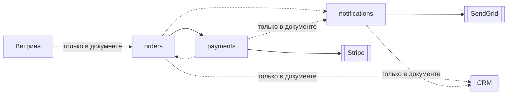

# Ландшафт

Системы за рамками одного проекта и связи между ними: кто кого вызывает, какие события ходят между системами, какие данные
и ресурсы общие. Собрано по коду репозиториев и по документации; что не сходится — в `RECONCILE.md`, чего нет нигде — в `QUESTIONS.md`.

Блоки `sa:auto` пересобирает `landscape.py build` (эвристики — сверяй с кодом). Свои уточнения пиши **вне** блоков.
Места с комментарием «заполнить» заполняет агент: источник — путь:строка в коде, документ или номер вопроса.

## Системы

### Список
<!-- sa:auto id="systems" -->
| Система | Назначение | Владелец | Где | Входящих / исходящих |
|---|---|---|---|---|
| [`orders`](systems/orders.md) orders | Заказы: оформление, статусы, отмена | Команда «Заказы» | orders | 1 / 2 |
| [`payments`](systems/payments.md) payments | Списание денег за заказ через Stripe | Команда Billing (канал #billing) | payments | 1 / 2 |
| [`notifications`](systems/notifications.md) notifications | Письма покупателям по событиям заказов | Команда «Коммуникации» | notifications | 1 / 1 |
| [`stripe`](systems/stripe.md) Stripe | Эквайринг: списание с карты | ⚠ | внешняя | 1 / 0 |
| [`sendgrid`](systems/sendgrid.md) SendGrid | Отправка писем | ⚠ | внешняя | 1 / 0 |
| [`crm`](systems/crm.md) CRM | Карточки покупателей, ведёт отдел продаж | Отдел продаж | внешняя | 0 / 0 |
| [`storefront`](systems/storefront.md) Витрина | Сайт магазина, вызывает Orders Service | ⚠ |  | 0 / 0 |
<!-- sa:auto-end -->

## Схема

### Кто от кого зависит
<!-- sa:auto id="diagram" -->

Сплошная стрелка — вызов, пунктир — только события; «только в документе» — связь есть на схеме, но не в коде.
<!-- sa:auto-end -->

## Связи

### payments → orders
<!-- sa:auto id="link:payments→orders" -->
- событие: payments.completed
- В коде: payments:app/api/payments.py:22 → orders:src/consumers/payments.ts:8 (kafka)
- В документах: ../docs/architecture.md:19
<!-- sa:auto-end -->
- **Зачем и как:** результат списания событием Kafka: orders ставит PAID или PAYMENT_FAILED (repos/orders/src/consumers/payments.ts:13); повтор события перезапишет статус тем же значением; ошибка обработки не обрабатывается — нет повтора и DLQ

### orders → notifications
<!-- sa:auto id="link:orders→notifications" -->
- событие: orders.created
- В коде: orders:src/routes/orders.ts:13 → notifications:notifications/worker.py:9 (kafka)
- В документах: ../docs/architecture.md:20
<!-- sa:auto-end -->
- **Зачем и как:** событием Kafka после создания заказа, до оплаты (repos/orders/src/routes/orders.ts:13); notifications шлёт письмо «заказ принят»; при недоступном notifications заказ не страдает

### orders → payments
<!-- sa:auto id="link:orders→payments" -->
- вызов: HTTP /api/payments, адрес payments, адрес из настройки PAYMENTS_URL
- В коде: orders:src/clients/payments.ts:5; orders:src/clients/payments.ts:1
- В документах: ../docs/architecture.md:18
<!-- sa:auto-end -->
- **Зачем и как:** синхронный POST /api/payments при оформлении (repos/orders/src/clients/payments.ts:5); при ошибке заказ остаётся NEW, клиент получает 502 (repos/orders/src/routes/orders.ts:23); повтор не идемпотентен (repos/payments/app/api/payments.py:20)

### payments → notifications (только в документе)
<!-- sa:auto id="doclink:payments→notifications" -->
- В коде: не найдено
- В документах: ../docs/architecture.md:21
<!-- sa:auto-end -->
- **Зачем и как:** по документу — письмо «оплата прошла» по payments.completed (docs/architecture.md:29); в коде нет, Q-002

### payments → stripe
<!-- sa:auto id="link:payments→stripe" -->
- вызов: адрес api.stripe.com
- В коде: payments:app/stripe_client.py:5
- В документах: упомянуты вместе: ../docs/architecture.md:7
<!-- sa:auto-end -->
- **Зачем и как:** синхронный HTTP к Stripe, таймаут 10 с (repos/payments/app/stripe_client.py:10); ошибка Stripe → исключение и 500 для orders

### notifications → sendgrid
<!-- sa:auto id="link:notifications→sendgrid" -->
- вызов: адрес api.sendgrid.com
- В коде: notifications:notifications/mailer.py:8
- В документах: ../docs/architecture.md:23
<!-- sa:auto-end -->
- **Зачем и как:** синхронный HTTP, таймаут 10 с (repos/notifications/notifications/mailer.py:8); ошибка роняет обработку сообщения

### storefront → orders (только в документе)
<!-- sa:auto id="doclink:storefront→orders" -->
- В коде: не найдено
- В документах: ../docs/architecture.md:17
<!-- sa:auto-end -->
- **Зачем и как:** витрина вызывает Orders Service (docs/architecture.md:17); репозитория витрины в ландшафте нет — не проверено

### orders → crm (только в документе)
<!-- sa:auto id="doclink:orders→crm" -->
- В коде: не найдено
- В документах: ../docs/architecture.md:22
<!-- sa:auto-end -->
- **Зачем и как:** по схеме — «новый покупатель» в CRM (docs/architecture.md:22); в коде orders вызова нет, см. RECONCILE

### notifications → crm (только в документе)
<!-- sa:auto id="doclink:notifications→crm" -->
- В коде: не найдено
- В документах: docs/architecture.md:30
<!-- sa:auto-end -->
- **Зачем и как:** по документу контакты из CRM (docs/architecture.md:30); в коде — из базы заказов, Q-001

## Общая инфраструктура

### Ресурсы
<!-- sa:auto id="infra" -->
- orders db (ORDERS_DB_URL) (база данных): notifications, orders — ⚠ общая
<!-- sa:auto-end -->

## Документы

### Что прочитано
<!-- sa:auto id="docs" -->
- ../docs/architecture.md — Архитектура магазина · схем: 7 связей · о системах: notifications, orders, payments, sendgrid, storefront, stripe
- ../docs/adr/0001-kafka-for-integration.md — ADR-0001. Интеграция сервисов через Kafka · ADR
- ../docs/asyncapi/payments.yaml — Payments Service · о системах: AsyncAPI
- ../docs/confluence/dev-standards.html — Стандарты разработки сервисов
- ../docs/confluence/payments-service.html — Payments Service · о системах: payments, stripe
<!-- sa:auto-end -->

## Архитектурные решения

### ADR
<!-- sa:auto id="adr" -->
- ../docs/adr/0001-kafka-for-integration.md — ADR-0001. Интеграция сервисов через Kafka
- Проверяемые принципы из них собирает ar-rules
<!-- sa:auto-end -->
