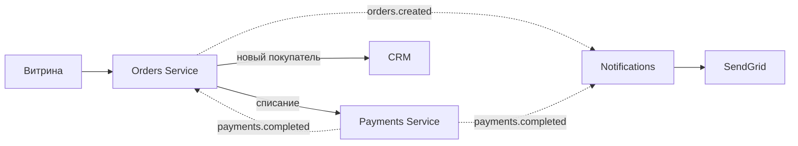

# Архитектура магазина

Обновлено: март. Владелец документа — архитектор платформы.

## Системы

- **Orders Service** — заказы: оформление, статусы, отмена. Команда «Заказы».
- **Payments Service** — списание денег через Stripe. Команда Billing.
- **Notifications** — письма и SMS покупателям. Команда «Коммуникации».
- **Витрина** — сайт магазина, вызывает Orders Service.
- **CRM** — карточки покупателей (внешняя система, ведёт отдел продаж).

## Схема

## Как это работает

Покупатель оформляет заказ на витрине. Orders Service создаёт заказ и синхронно вызывает Payments Service.
Результат оплаты приходит событием `payments.completed`: Orders Service меняет статус, Notifications отправляет письмо
«оплата прошла». Контакты покупателя Notifications берёт из CRM. Возвраты публикуются событием `payments.refunded`.

Между сервисами — только API и события Kafka (см. ADR-0001).
